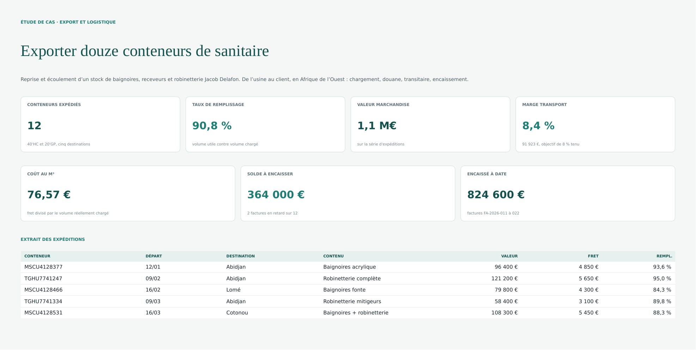
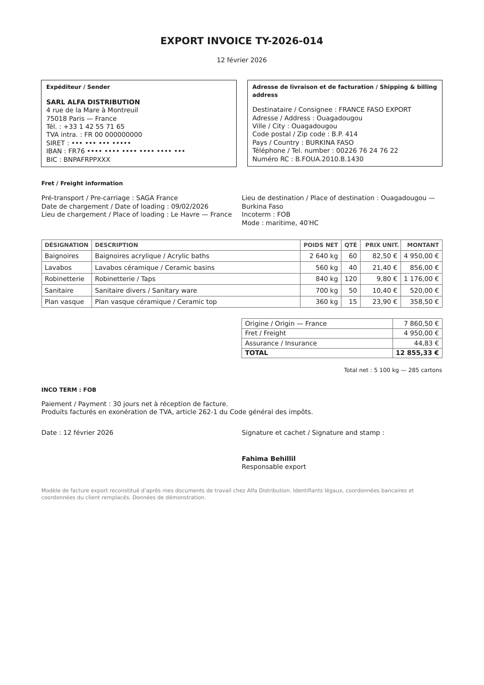

# Suivi export — conteneurs de sanitaire

Un classeur de pilotage export pour l'écoulement d'un stock de baignoires, receveurs et robinetterie (Jacob Delafon) revendu à l'export, en Afrique de l'Ouest.

Contexte : une SARL montée à cinq associés pour reprendre un gros stock et le revendre. J'ai pris en charge tout le processus export, de l'usine à la réception client : plan de chargement, volumétrie, dossier douanier, transitaire, suivi et encaissement.

## Les quatre chiffres

| Indicateur | Valeur |
|---|---|
| Conteneurs expédiés | 12 (40'HC et 20'GP) |
| Taux de remplissage moyen | 90,8 % |
| Valeur marchandise | 1,1 M€ |
| Marge transport | 91 923 €, soit 8,4 % |

## Ce que contient le classeur

- **Lecture** — le contexte et la règle d'or.
- **Conteneurs** — 12 expéditions : destination, contenu, type, valeur, fret, marge, statut.
- **Volumétrie** — volume utile contre volume chargé, taux de remplissage, coût au m³. Un conteneur mal chargé, c'est du vide payé au prix du fret.
- **Douane** — valeur FOB, fret, assurance, valeur en douane, transitaire, bon pour paiement, statut documentaire.
- **Paiements** — factures, échéances, encaissements, soldes et retards.
- **Tableau de bord** — les six indicateurs qui comptent.

## La logique, en trois règles

1. **Coût au m³** : fret divisé par le volume réellement chargé. C'est l'indicateur qui dit si le conteneur est rentable.
2. **Valeur en douane** : FOB + fret + assurance.
3. **Solde dû** : montant facturé moins encaissé, avec le retard en jours.

## Les documents que je produisais

Le classeur n'était qu'une moitié du travail. L'autre, c'étaient les documents commerciaux et douaniers, rédigés un par un avant chaque départ.

[Voir le modèle de facture export (PDF)](documents/modele-facture-export.pdf)

En-tête expéditeur avec mentions légales, adresse de livraison et de facturation du consignataire, informations de fret, lignes de marchandises avec poids net, quantité, prix unitaire et montant, totaux, incoterm, conditions de paiement, clause d'exonération de TVA et signature.

## Comment l'ouvrir

Télécharger `Suivi-export-conteneurs-sanitaire.xlsx` et l'ouvrir dans Excel, LibreOffice ou Google Sheets.

L'étude de cas complète est dans [ETUDE-DE-CAS.md](ETUDE-DE-CAS.md).

## Auteure

**Fahima Behillil** — chargée de projet IA & automatisation
[LinkedIn](https://linkedin.com/in/fahima-be) · [GitHub](https://github.com/Fahima94) · horizonsdatas@gmail.com

> Données de démonstration, calibrées sur les volumes réels. Aucun tarif fournisseur ni nom de client réel.
